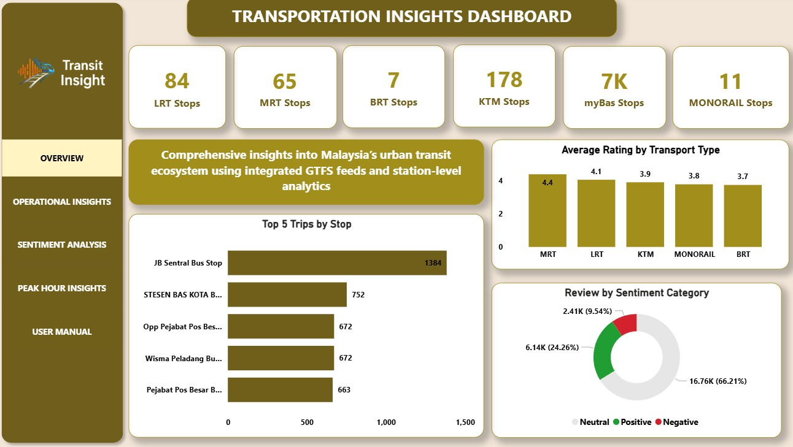
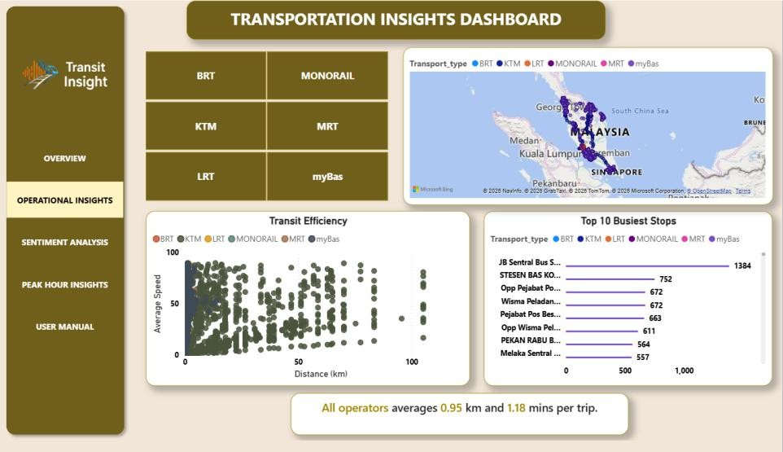
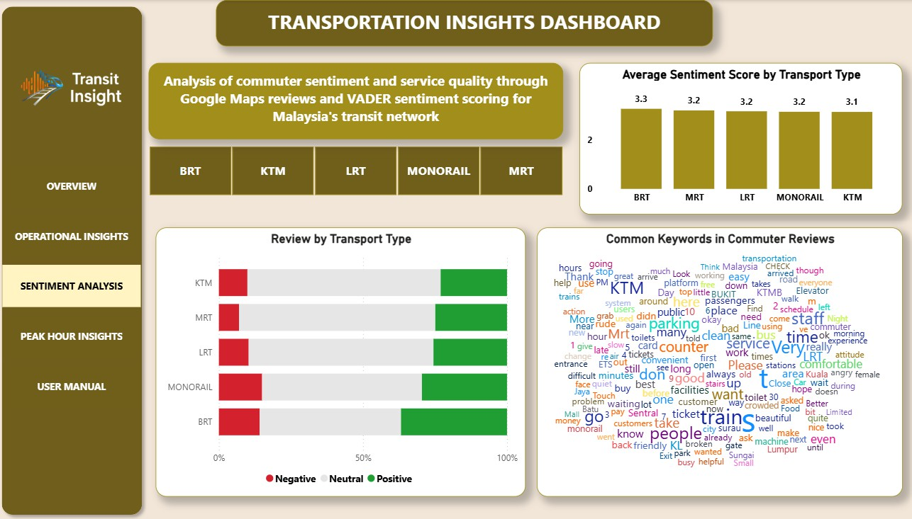
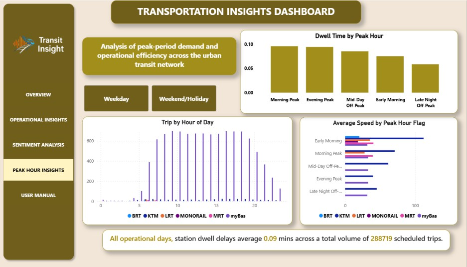

# Urban Mobility Intelligence

**A Big Data Dashboard Integrating GTFS Schedules and Commuter Sentiment in Malaysia**

Final Year Project by **Muhammad Firas Haiman Bin Taha** · Bachelor of Information Technology (Hons.), Universiti Teknologi MARA

[Open the Power BI report](https://app.powerbi.com/view?r=eyJrIjoiYTE1YTBlMGUtMTUzMC00NDZjLThmN2ItMmRlYWUyMmI3NzYxIiwidCI6ImNkY2JiMGUyLTlmZWEtNGY1NC04NjcwLTY3MjcwNzc5N2FkYSIsImMiOjEwfQ%3D%3D&pageName=682d2257edbe6009a410) · [Dashboard page](https://amadslah62.wixsite.com/transit-insight/dashboard) · [Project website](https://amadslah62.wixsite.com/transit-insight)

## Problem and objectives

Public transport schedules are published across different operators, while commuter feedback is recorded separately in station reviews. This project brings both sources into a single Power BI report so users can explore scheduled services alongside commuter ratings and sentiment.

- Standardize GTFS schedule data across KTMB, Prasarana and selected BAS.MY networks in Peninsular Malaysia.
- Classify commuter review sentiment and present it alongside station ratings.
- Build an interactive report for exploring routes, modes and scheduled activity by time of day.
- Evaluate the platform through a quasi-experimental pre/post study and user acceptance testing.

## Analytical workflow

1. **Prepare schedule data with Python and Pandas.** Join GTFS routes, trips, stops, stop times and service calendars. Derive scheduled dwell and travel times between stops, then classify records by time period.
2. **Prepare and score reviews.** Join review exports to station metadata by `place_id`. Use NLTK VADER to score English translations where available, with the original review text as a fallback.
3. **Store and query analytical tables.** Use Hadoop HDFS for storage and Apache Hive for querying.
4. **Build the Power BI report.** Model the prepared data and use DAX measures to support interactive filtering and comparisons. Present the report through the Wix project website.

## Dashboard pages

| Page | What it covers |
|---|---|
| Overview | Summary of the transport and commuter feedback data |
| Operational Insights | Routes, stops and schedule-derived metrics |
| Sentiment Analysis | Station ratings and review sentiment |
| Peak Hour Insights | Scheduled activity across time periods |
| User Manual | How to navigate and use the dashboard |

## Dashboard preview

Screenshots from the submitted FYP. Use the live Power BI link above to interact with the report and its filters.

### Overview

### Operational Insights

### Sentiment Analysis

### Peak Hour Insights

The schedule data describes planned service. The time-period charts summarize scheduled activity and do not measure passenger demand.

## Project documentation

- [Data sources and column definitions](docs/data-dictionary.md)
- [How to run the reconstructed Python pipelines](docs/running-the-project.md)

## Findings from the original outputs

- The final operations export contains **288,719 rows** across KTM, LRT, MRT, Monorail, BRT and BAS.MY. BAS.MY accounts for **283,236 rows**, so comparisons across modes should account for the difference in dataset size.
- In the export's `Peak_Hour_Flag` field, **Mid-Day Off-Peak** is the most common named time period, with **127,155 rows**.
- The sentiment export contains **25,317 review records**. The most frequent label was **Neutral**. The original scoring workflow also assigns a zero score when review text is missing, which affects how the neutral category should be interpreted.

## Evaluation and limitations

The FYP evaluated the platform through a quasi-experimental pre/post study and user acceptance testing. The acceptance testing covered perceived ease of use, perceived usefulness, attitude and behavioural intention.

- GTFS represents planned service. Schedule-derived metrics cannot measure actual ridership, delays or cancellations.
- Coverage varies by operator and region. The dashboard reflects the feeds and station reviews available for the project.
- Review sentiment depends on which users leave feedback, the quality of translations and how VADER handles context and mixed-language text.
- The public project showcase uses the live dashboard and documentation. The Google Maps review exports are kept private.

## Data source

Official GTFS feeds are published by Malaysia's open data portal under **CC BY 4.0**. The project combines source tables and derives additional analytical fields.

[GTFS Static API documentation](https://developer.data.gov.my/realtime-api/gtfs-static.en) · [CC BY 4.0 licence](https://creativecommons.org/licenses/by/4.0/)
